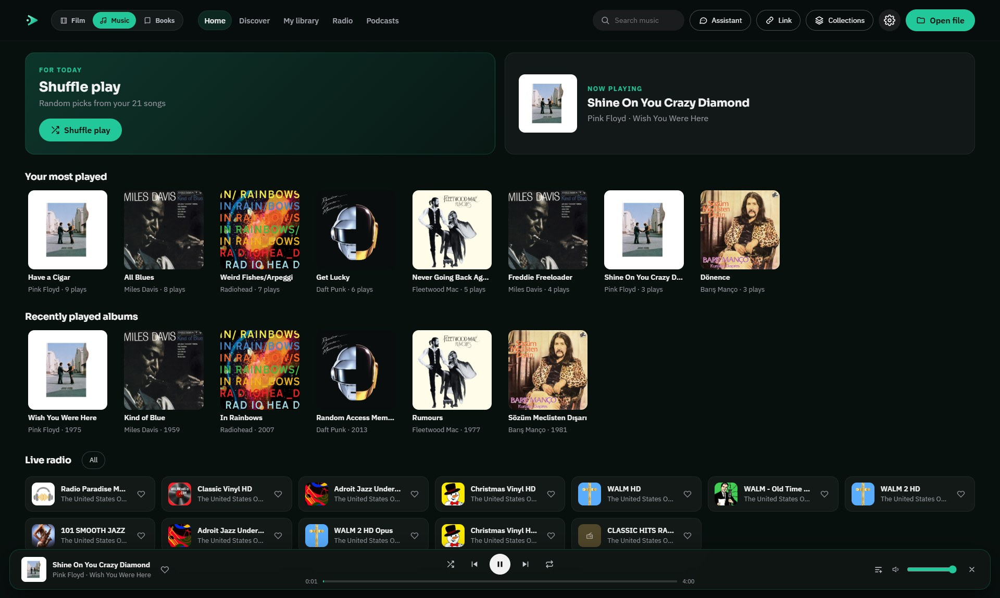
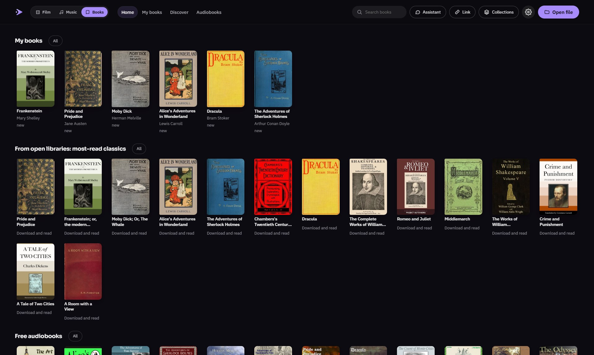
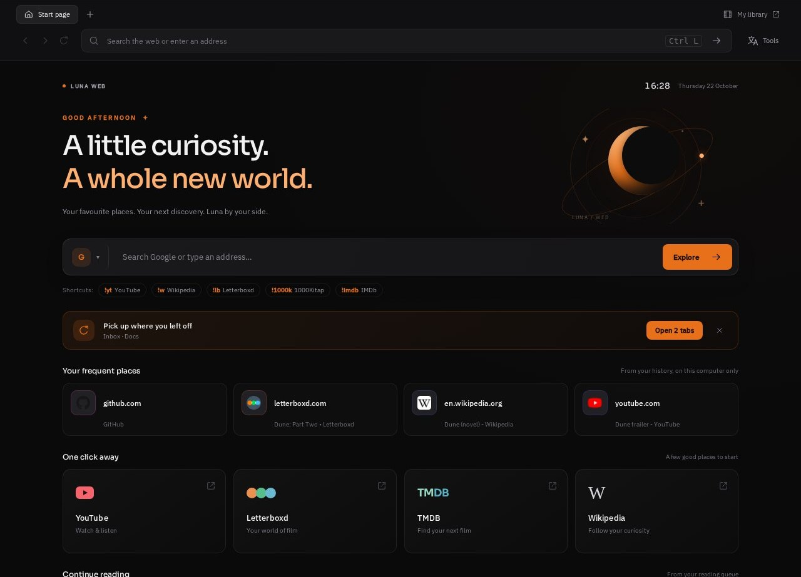

> Yeni tur: [12 günlük kullanım geliştirmesi ve doğrulama](docs/LUNA-GUNLUK-GELISTIRMELER.md).

> Yerel birleşik teslim (22 Ekim 2026): [birleştirme ve doğrulama raporu](docs/CLAUDE-BIRLESTIRME-20261022.md). Eklenti/indirme işlemleri için güncel [Luna Web yönetim belgesini](docs/LUNA-BROWSER-EKLENTI-INDIRME.md) esas alın.

  

<h1 align="center">Luna Player</h1>

  Your films, series, music and books in one good-looking app. 
  It organises your collection, helps you decide what to watch, hear and read, and plays almost anything.

  <a href="../../releases/latest"><b>⬇ Download for Windows</b></a>

## Three parts, one app

Switch between **Film**, **Music** and **Books** at the top left. Each part has its own colour, its own library and
its own home screen, and the assistant knows all three.

### Film

**Your films, nicely organised.** Point Luna at the folders where you keep your videos. It recognises each film and
series and adds posters, summaries, cast and trailers, so your collection looks like a streaming service.
It remembers where you stopped.

**Plays almost anything.** Luna is built on [mpv](https://mpv.io), so nearly every video format just works.
If a film has no subtitles, Luna finds them for you.

**Helps you choose.** Like or dislike what you watch and Luna learns your taste. Add the films your friends
recommend, or connect their Letterboxd, and see everything in one place.

**Open links and torrents.** Like VLC's "Open network stream": paste a video link (http, m3u8, rtsp…), a magnet
link or a `.torrent` file, and Luna plays it. Torrents start playing while they download. Press **Ctrl+N** or just
paste a link into the window.

**Sharper picture with AI upscaling.** If you have [Lossless Scaling](https://store.steampowered.com/app/993090/Lossless_Scaling/)
(a paid app on Steam), Luna switches it on for you while a video plays: sharper lower-resolution videos and smoother
motion, with subtitles kept crisp on top. Press **Q** in the player or use the **UP** menu.

### Music

**Your music archive, like a streaming app.** Add your music folder and Luna builds albums, artists and covers from
the files' tags (MP3, FLAC, M4A, OGG, OPUS, WAV…). Shuffle, your most played, recently played albums, likes and
playlists, plus synced lyrics that light up line by line. Live radio stations from around the world and podcasts
are one tab away.

### Books

**Read and listen.** EPUB, PDF and comics (CBZ) open in a calm reader with themes, bookmarks, highlights and notes,
and Luna can read a book aloud. Classics from open libraries (Project Gutenberg, Wikisource) download with one
click, and free audiobooks from LibriVox play right away.

### Web

**A small browser inside Luna.** Open **◎ Web** at the top for tabs, favourites and your own start page. Type a word
to search with the engine you like, or use shortcuts: `!yt dune trailer` goes straight to YouTube, `!w Moon` to
Wikipedia, `!lb` to Letterboxd. Suggestions come from your open tabs, favourites and history. History stays on your
computer and has a pause switch. Find in a page (**Ctrl+F**), a calm reading view (**Ctrl+Shift+R**) with themes and
read-aloud, mute a tab (**Ctrl+M**), and one click on **Play in Luna** opens a video page in Luna's own player.

### Web

**A small browser of its own.** The **Web** tab opens real web pages next to your films, songs and books, with tabs, favourites, downloads, page zoom, page translation and a reading list. The address bar suggests open tabs, favourites and pages you visited recently while you type (arrow keys and Enter; the typed text always comes first), and searches with Google, DuckDuckGo, Bing, Brave, Startpage, Ecosia or Yandex, your choice. Right-click a tab for reload, duplicate, copy link and "close others". Press **F9** for a calm **reading view** of any article (themes, text size, contents, and Ctrl+F to find inside it), zoom is remembered per site, and the start page offers to **continue reading** where you stopped. The recently visited list stays on your computer, can be cleared at any time or switched off, and **F1** in Web shows every shortcut. **Ctrl+K** opens a command palette: in Web it finds commands, open tabs, favourites and history; in the library it jumps between Film, Music, Books and Web and finds any film or series you own. Type `!yt dune`, `dune !w` or `!tmdb dune` for quick searches on YouTube, Wikipedia, TMDB, Letterboxd, Goodreads, Spotify, Maps and more. Pin tabs, drag them into the order you like, and press **Ctrl+H** for your history by day. The start page greets you with the time and tonight's real moon, and keeps the sites you visit most. In the reading view, **Listen** reads the article aloud with your system voices and lights the paragraph being read.

## An assistant that sees what's open

Ask things like *"What should I watch tonight?"*, *"Play something calm"* or *"Which book is this film based on?"*.
The assistant knows the film page, the song or the book you have open; when more than one is open (a song playing
while you look at a film), it asks which one you mean. It can play music, find free books, and answer with posters,
cast and links. Open it from anywhere with **Alt+A**.

**Collections.** Ask for a collection about anything ("everything Dune") and the assistant gathers the films,
songs and books on that topic into one page. One history keeps what you watched, listened to and read.

## And more

- **Updates by itself:** Luna finds new versions and installs them (signed, so only real Luna updates go in).
- **A backup in one file:** your library, likes, history and settings, to keep or move to another computer.
- A first-run tour, and a check that tells you if anything is missing, with download links
- Hide posters of films with disturbing content (optional)
- English and Turkish (change it in Settings)

## Getting started

1. Download **`Luna.Player_…_x64-setup.exe`** from the [Releases](../../releases/latest) page and run it.
   It works on Windows 10 and 11.
2. If Windows shows *"Windows protected your PC"*, click **More info → Run anyway**.
   This appears because Luna is a small free project without a paid code-signing certificate.
3. A short tour shows you around on first launch.

### Portable version

There is also a **`Luna.Player_…_x64-portable.zip`** on the same Releases page. Extract it anywhere and run
`Luna Player.exe`; it needs no installer (WebView2 must already be on the computer, which is the case on
Windows 10/11).

### Optional: free keys for the extra features

Luna plays films, music and books without any setup. For posters, the assistant and subtitle search, add these
free keys in **Settings**:

| Key | Unlocks | Get it here |
|---|---|---|
| TMDB | Posters, summaries, cast, recommendations | [themoviedb.org](https://www.themoviedb.org/settings/api) |
| Gemini | The assistant, collections and translations | [aistudio.google.com](https://aistudio.google.com/apikey) |
| OpenSubtitles | Automatic subtitles | [opensubtitles.com](https://www.opensubtitles.com/consumers) |

Your keys and your library stay on your own computer.

## Handy shortcuts

| Key | Action |
|---|---|
| Alt+A | Open / close the assistant |
| Ctrl+O | Open a file |
| Ctrl+N | Open a link |
| Space | Play / pause (hold for 2× speed in a film) |
| ← / → | Skip back / forward |
| Ctrl+← / Ctrl+→ | Previous / next song |
| F or double-click | Full screen |
| S | Subtitle timeline |
| Q | AI upscaling on / off (needs Lossless Scaling) |
| Esc | Close a window or panel, then leave the film |
| Ctrl+T / Ctrl+W | New / close a tab in Web |
| Ctrl+L, Ctrl+F, Ctrl+H | Address bar, find in page, history in Web |
| Ctrl+Shift+R, Ctrl+M | Reading view, mute the tab in Web |

| Ctrl+L / F1 (in Web) | Focus the address bar / show all Web shortcuts |

## For developers

Want to build it yourself or help out? See [BUILDING.md](BUILDING.md) and [CONTRIBUTING.md](CONTRIBUTING.md).
The source is the whole repository: React/TypeScript in `app/src`, Rust/Tauri in `app/src-tauri`.
What changed in each version: [CHANGELOG.md](CHANGELOG.md).

## Please use it responsibly

Luna is a player: it doesn't come with any content, sites or search sources. Only open and download videos you
have the right to watch. Downloading copyrighted material without permission is illegal in many countries.
The free books and audiobooks come from Project Gutenberg, Wikisource and LibriVox, whose works are in the
public domain in the United States; check the rules where you live.

Friends' Letterboxd lists are read from their public Letterboxd pages. This is not an official Letterboxd feature.

## License

Luna Player is free and open source under the [GPL-3.0](LICENSE) license.

The source code is this repository. Contributions are welcome; read [CONTRIBUTING.md](CONTRIBUTING.md) and
[SECURITY.md](SECURITY.md) first. The installers include GPLv2+ mpv and Unlicense yt-dlp binaries; see
[THIRD-PARTY-NOTICES.md](THIRD-PARTY-NOTICES.md) for their licenses, source links and the shipped copyright texts.

This product uses the TMDB API but is not endorsed or certified by TMDB.
The installer includes [mpv](https://mpv.io) ([license](https://github.com/mpv-player/mpv/blob/master/Copyright),
[source](https://github.com/mpv-player/mpv)), built by [shinchiro/mpv-winbuild-cmake](https://github.com/shinchiro/mpv-winbuild-cmake).
Lossless Scaling is a separate product and is not part of Luna.
