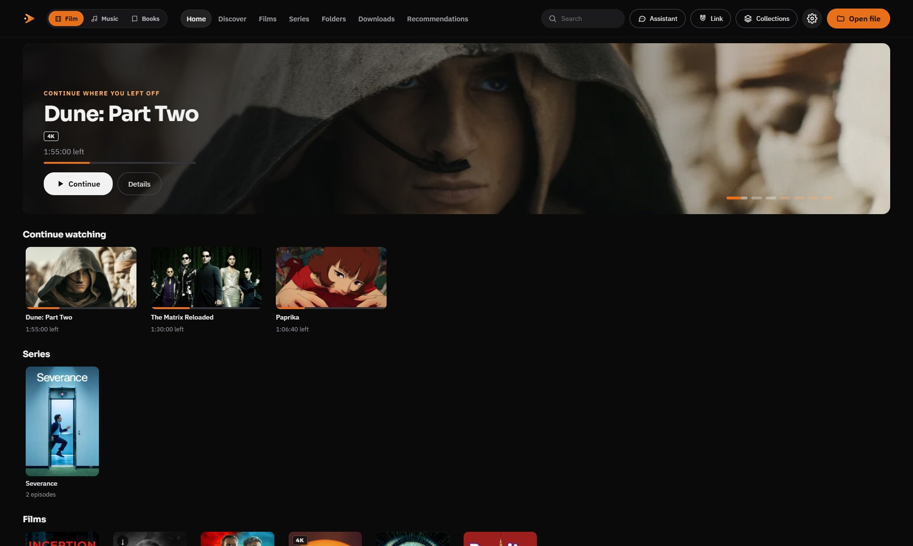
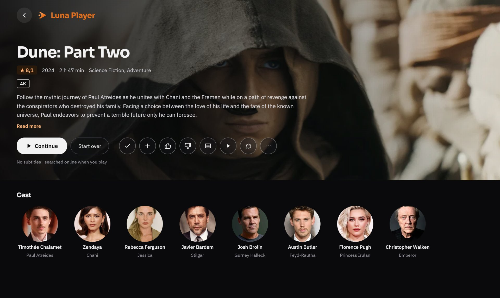
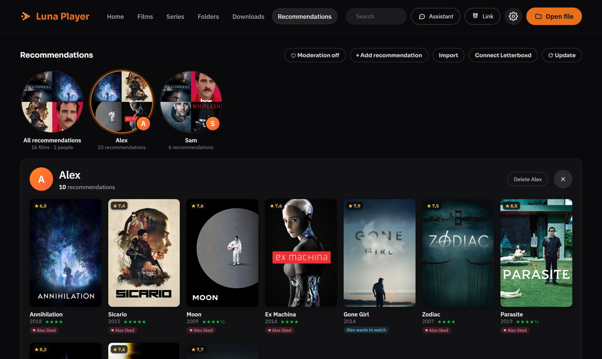
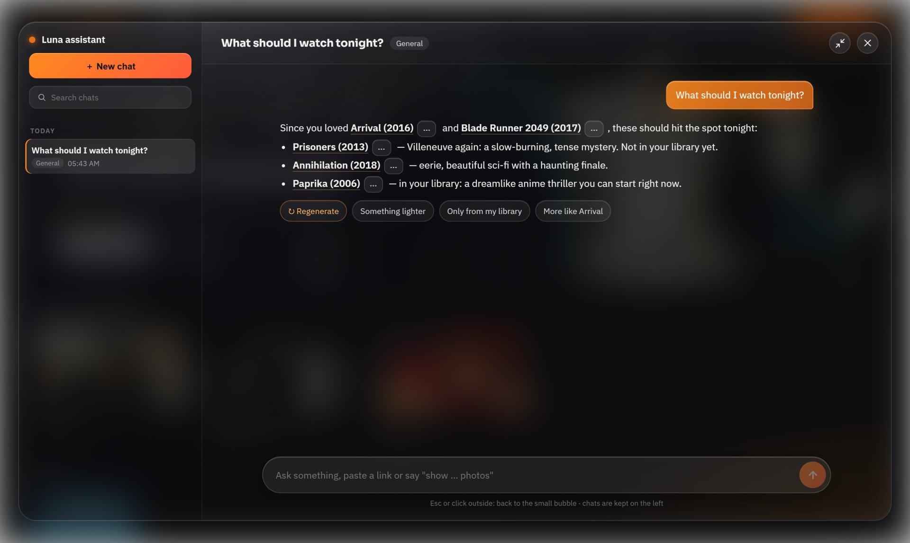
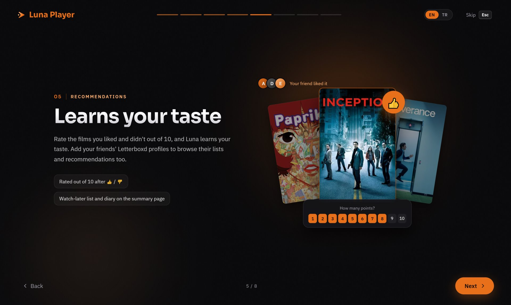

  

<h1 align="center">Luna Player</h1>

  A good-looking video player for your films and series. 
  It organises your collection, helps you decide what to watch, and plays almost anything.

  <a href="../../releases/latest"><b>⬇ Download for Windows</b></a>

## What it does

**Your films, nicely organised.** Point Luna at the folders where you keep your videos. It recognises each film and
series and adds posters, summaries, cast and trailers, so your collection looks like a streaming service.
It remembers where you stopped.

**Plays almost anything.** Luna is built on [mpv](https://mpv.io), so nearly every video format just works.
If a film has no subtitles, Luna finds them for you.

**Helps you choose.** Like or dislike what you watch and Luna learns your taste. Add the films your friends
recommend, or connect their Letterboxd, and see everything in one place.

**A film assistant you can talk to.** Ask things like *"What should I watch tonight?"* or *"Who's in Dune?"*
and get answers with posters, cast and links.

**And more:**
- Open links and torrents directly and start watching while they download
- Hide posters of films with disturbing content (optional)
- English and Turkish (change it in Settings)

## Getting started

1. Download **`Luna.Player_…_x64-setup.exe`** from the [Releases](../../releases/latest) page and run it.
   It works on Windows 10 and 11.
2. If Windows shows *"Windows protected your PC"*, click **More info → Run anyway**.
   This appears because Luna is a small free project without a paid code-signing certificate.
3. A short tour shows you around on first launch.

### Optional: free keys for the extra features

Luna plays videos without any setup. For posters, the assistant and subtitle search, add these free keys in **Settings**:

| Key | Unlocks | Get it here |
|---|---|---|
| TMDB | Posters, summaries, cast, recommendations | [themoviedb.org](https://www.themoviedb.org/settings/api) |
| Gemini | The film assistant and translations | [aistudio.google.com](https://aistudio.google.com/apikey) |
| OpenSubtitles | Automatic subtitles | [opensubtitles.com](https://www.opensubtitles.com/consumers) |

Your keys and your library stay on your own computer.

## Handy shortcuts

| Key | Action |
|---|---|
| Space | Play / pause |
| ← / → | Skip back / forward |
| Mouse wheel | Volume |
| F or double-click | Full screen |
| S | Subtitles |
| Ctrl+N | Open a link |

## For developers

Want to build it yourself or help out? See [BUILDING.md](BUILDING.md).

## License

Luna Player is free and open source under the [GPL-3.0](LICENSE) license.
Film data is provided by [TMDB](https://www.themoviedb.org); Luna is not endorsed or certified by TMDB.
