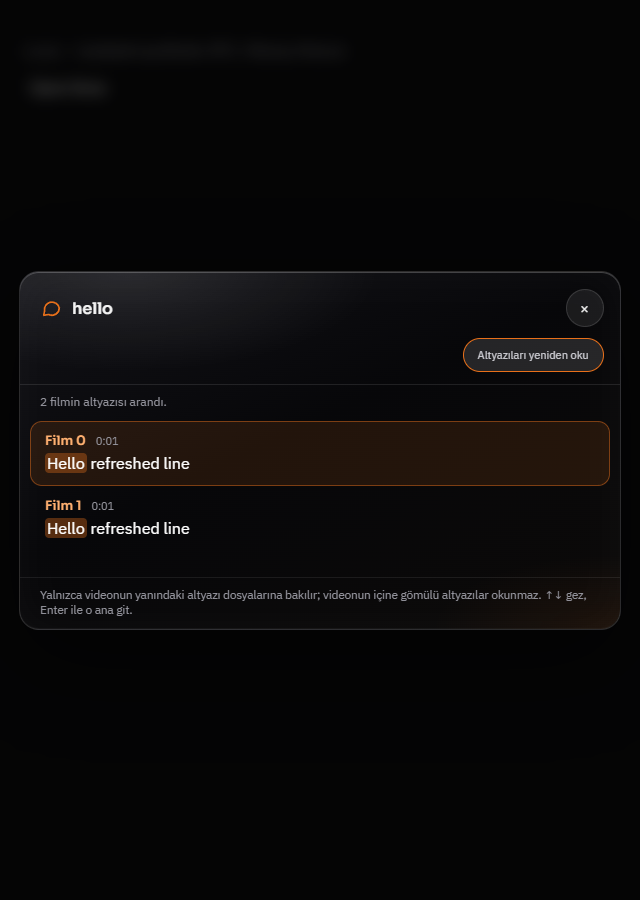
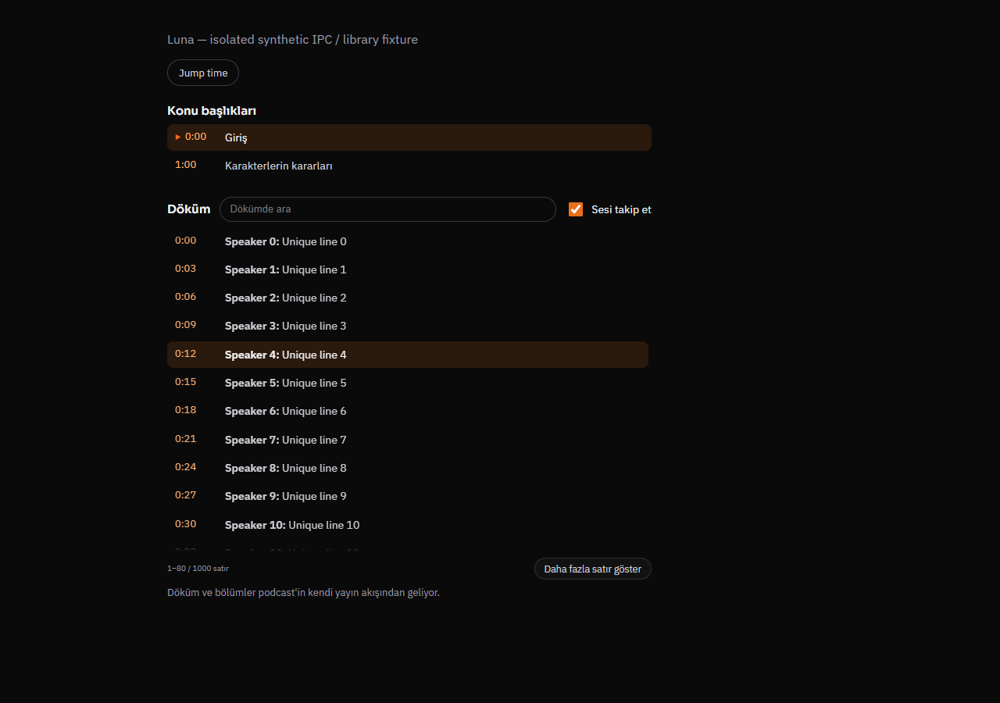

# Luna beta — performans ve kullanım devamı

23 Ekim 2026. Mevcut birleşik v1.6.7 beta kaynağı üzerinde devam edildi; önceki ek denetim düzeltmeleri korunur. Bu tur yeni ZIP, commit, push veya sürüm değişikliği yapılmadı. Daha önce teslim edilen nihai ZIP bu devamı içermez.

## Değişiklikler

### Film kütüphanesi

- Aynı filmin çok sayıda dosya sürümünde kopya sayısı artık her sürüm için bütün grubu yeniden taramaz. Dosya yolları grup başına bir kez toplanır.
- Kopyaların son izlenme sırasını hesaplayan işlem, sıralama sırasında aynı dosyaları tekrar tekrar dolaşmaz.
- Bitirildi sorgusu bir katalog hesaplamasında dosya başına bir kez yapılır. Sonraki hesaplama güncel izlenme durumunu yeniden okur; eski sonuç kalıcı olarak önbelleğe alınmaz.
- Kopyalar, dizi bölüm sayıları, kaldığın yer ve devam dosyası seçimi korunur.

### Replik arama

- Altyazı indeksinin oturum önbelleği 80 kayıt, iki milyon tahmini ağırlık birimi ve 120 saniye yaş ile sınırlandı. Ağırlık metin/arama indeksi karakterleri ve satır başına yaklaşık ek paydır; kesin RAM ölçümü değildir.
- Pencere kapandıktan sonra dönen eski okuma sonucu indekse eklenmez ve önbelleğe yazılmaz. Yeni dosya okumalarının planlanması durur. Native tarafa zaten gönderilen çağrı fiziksel olarak iptal edilmez.
- **Altyazıları yeniden oku** düğmesi arama metnini koruyarak önbelleği temizler ve dosyaları tekrar okur.
- Tam veya kısmi okuma hataları belirtilir; okunamayan dosyalar varken “hiçbir altyazıda geçmiyor” sonucu verilmez.
- Etki yeniden çalıştığında eski tarama dizisi paylaşılmaz. Boş/küçülen sonuçlarda klavye seçimi geçerli aralıkta tutulur.
- Dar pencerede arama, kapat ve yeniden okuma kontrolleri iki düzenli satıra yerleşir.

### Podcast

- Aynı yayın akışının eşzamanlı okumaları ortak istek kullanır. Akış önbelleği 12 kayıt/90 saniye, bölüm sonucu 24 kayıt/5 dakika ve her biri iki milyon tahmini ağırlık birimi ile sınırlıdır. Bunlar yalnız oturum belleğindedir.
- Başarısız istekler ve eksik bölüm sonuçları kalıcı boş sonuç olarak önbelleğe alınmaz. Kullanıcı yeniden deneyebilir.
- Bölüm başlıkları ve döküm bağımsız olarak paralel okunur. Yayıncının ilk döküm biçimi açılamazsa sonraki biçimi denenir.
- Uzun zamanlı döküm başlangıçta 80 satırlık pencere çizer. Çalan bölüm takip edilir; takip kapatıldığında mevcut pencere korunur. Önceki satırlara ve daha fazla satıra erişim vardır.
- Arama bütün döküm üzerinde çalışır; yalnız çizilmiş satırlarla sınırlanmaz. Arama için katlanmış metin dizini veri değişince hazırlanır.
- Otomatik kaydırma yalnız döküm kutusunu hareket ettirir; azaltılmış hareket tercihi dikkate alınır.

### Asistan ve film notları

- Sohbet dizini ilk 100 sonuçtan sonra **100 sonuç daha göster** ile devam eder. Arama bütün dizinde çalışır; sonuçtan asıl mesaja geçiş korunur.
- Sohbet dizininde her tuşta bütün mesaj metinlerini tekrar normalleştirmek yerine hazırlanmış indeks ve ertelenmiş arama kullanılır.
- Film analizi kurtarma kaydında geçici kota/yazma hatası kalıcı engel oluşturmaz; **Kurtarma kaydını yeniden dene** eklenir.
- Değişmeyen kurtarma taslağı tekrar yazılmaz. Başka pencerenin değiştirdiği veya baştan hasarlı kayıt üzerine yazılmaz.

### Tarayıcı geçmişi

- Filtreleme, sıralama ve görünür gruplar ilgili girdilere göre yeniden kullanılır; arama ertelenir.
- **Bu siteyi unut** onayından sonra tek toplu geçmiş güncellemesi yapılır. Her ziyaret için ayrı kayıt güncellemesi yapılmaz. Tek satır silme ve mevcut onaylar korunur.

## Ölçülen sonuçlar

| Sentetik kontrol | Önce | Sonra |
|---|---:|---:|
| Aynı filmin 800 sürümünde dosya yolu erişimi | 645.598 | 5.600 |
| Aynı hesaplamada bitirildi sorgusu | 1.600 | 800 |
| 1.000 satırlık zamanlı dökümün ilk çizimindeki satır düğmesi | 1.000 | 80 |
| 120 ziyaretli siteyi unutmada bileşen güncelleme çağrısı | 120 | 1 |

800 sürümlük katalog örneğinin sonucu önce/sonra eşit kaldı. Tek yerel süre örneği yaklaşık 90,4 ms → 3,0 ms idi; bu küçük sentetik iş yükünün ölçümüdür, bütün uygulama/FPS/açılış hızına genellenemez. Çizilen satır sayısının azalması bütün dökümün bellekten kaldırıldığı anlamına gelmez.

## Doğrulama

- Yeni `npm run test:performance-workflows`: **12/12**. Ağırlıklı LRU, yüklenmeden itibaren süre sınırı, eşzamanlı istek paylaşımı, hatadan sonra tekrar deneme, geç tamamlanan isteğin yeniyi bozamaması ve katalog sonuç/sayım kontrolleri.
- Etkilenen mevcut kontroller: library **9**, creative-plus **12**, extras-plus **20**, browser-magic **23**, unified **5**, library-workbench **9**, quality-30 **30**, claude-integration **7**; geçti.
- Önceki audit-fixes **20/20** ve fifty-behavior **50/50** yeniden geçti.
- İngilizce metin denetimi ve `tsc && vite build` geçti. Derleme mevcut büyük parça/etkisiz dinamik import uyarılarını vermeye devam eder; paket boyutu küçüldüğü iddia edilmez.
- Başsız Edge: gerçek bileşenler, donmuş taklit Tauri köprüsü ve sentetik veriyle **13 önce/sonra senaryo kaydı**. 640/1280 px ve Türkçe/İngilizce örnekleri; döküm takibi/sayfalama/arama, ağ hatası/alternatif döküm, kapanmış replik aramasının geç sonucu, yeniden okuma, kota sonrası kayıt, kayıt çatışması, sohbet dizini ve toplu geçmiş silme kontrol edildi. JS sayfa hatası ve yatay taşma görülmedi. Bu sayı 13 farklı native hata bulunduğu anlamına gelmez.
- Üretim Rust kodu, bağımlılıklar ve kilit dosyaları değiştirilmedi. Gerçek Windows Luna penceresi, mpv ve canlı podcast ağı denenmedi.

Ekran örnekleri ve sayısal sonuçlar: `docs/evidence/performance/`. Yerel tekrar üretim araçları ve önceki kaynak görüntüsü ayrı çalışma dizinindeki `beta-performance-evidence/` içinde tutulur; bunlar kullanıcı verisi içermez.

