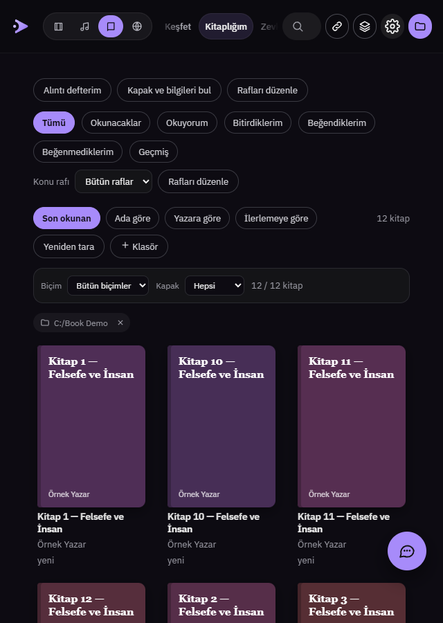
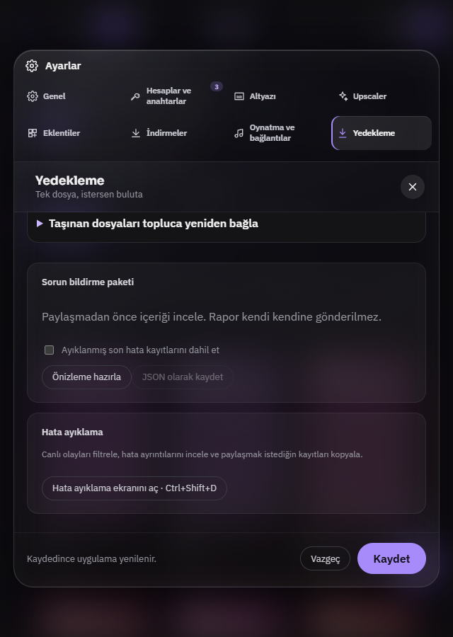
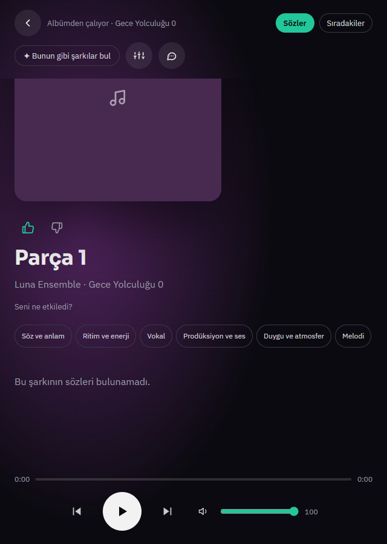

# Luna beta — gelen görsel bulguların tamamlanması

23 Ekim 2026. Kullanıcının paylaştığı Claude sohbet dökümü mevcut birleşik beta kaynağıyla karşılaştırıldı. Dökümdeki komutlar uygulanmadı; bulgular yeniden kontrol edilerek aşağıdaki düzeltmeler yapıldı. Önceki performans ve ek denetim çalışmaları korunur. Yeni ZIP, commit veya push yapılmadı; önceki nihai ZIP bu devamı içermez.

Taban: önceki turlarda doğrulanan v1.6.7, `3c4ae8f55ae792e9abe43fb9c3cf67c506b61bd6` üzerine birikmiş yerel kaynak. Bu tur yeni uzak sürüm indirilmedi.

## Tamamlananlar

| Bulgu | Sonuç |
|---|---|
| İşaretsiz onay kutuları koyu temada beyaz | Kök `color-scheme: dark` oldu. Ayarlar, SponsorBlock ve debug kutuları koyu yerel kontrol olarak çiziliyor. |
| Debug kategorileri sabit mor | `--accent-soft` kullanılır; etkin modun rengi izlenir. |
| Asistanın Yeni sohbet düğmesi müzik/kitapta kırmızıya dönüyor | Gradyanın iki ucu mevcut modun `--accent-soft` ve `--accent` değerlerini kullanır. |
| Kitap durum filtreleri 220 px raf kartlarına dönüşüyor | Yalnız `.seg-row.bk-shelves` esnek satır oldu. Diğer `.bk-shelves` koleksiyon kartı ızgarası korunur. |
| Konu rafı seçimi çevresindeki kontrollerden büyük | Etiket ve seçim 13 px, hizalı ve sarılabilir hale geldi; seçimin yüksekliği/boşluğu kompakt kontrollerle eşleşti. |
| Ayar kartı başlıkları farklı boyutlarda | Yalnız Ayarlar içindeki doğrudan kart başlıkları mevcut 13 px/600 standardına alındı. Sayfa başlığı ve alt bölüm başlıkları korunur. |
| Asistanın “Açık sayfa yok…” açıklaması kesiliyor | Açıklama artık satıra sarılır. Yakalanmış sayfa başlığı da uzun metni sarabilir; işlem düğmelerinin kapsayıcısına metin kırpma kuralı uygulanmaz. |
| Yedekleme sonunda açıklamasız tek chip | Debug başlatıcı başlık/açıklama içeren bir ayar kartına alındı; Ctrl+Shift+D kısayolu korunur. |
| Debug Ayarlar'ın arkasında kalıyor — ek bulgu | Genel `.modal-bg` kuralı debug'un z-index değerini 60'a düşürüyordu. Daha belirgin `.modal-bg.debug-bg` seçicisiyle 25.000 uygulanır; debug kapatma düğmesine tıklanabilir. |
| Tanılama onay kutusu etiketin üstünde ortalanıyor — ek bulgu | Ayarların sütun etiket kuralından `.extra-check` ayrıldı; kutu ve açıklaması aynı yatay satırda. |
| Dar Şimdi çalıyor ekranında kapak/tercihler kontrol çubuğuna taşıyor — ek bulgu | Kapak sütun genişliğini aşmaz. Dar görünümde içerik tek sütunda kayar, üst kontroller sarılır ve oynatma çubuğu ayrı alanda kalır. Geniş görünümde sol içerik gerektiğinde kendi içinde kayar. |

Üretim dosyaları: `app/src/App.css`, `BookMusic.css`, `Browser.css`, `DebugPanel.css`, `Screens.tsx`, `Music.tsx`. Veri anahtarları, kayıt biçimleri, medya komutları ve native sınır değiştirilmedi.

## Tekrar uygulanmayanlar

- **Inter:** Raporda sözü edilen App.css kuralları bu çalışma kaynağında zaten IBM Plex Sans kullanıyordu. Paketlenmiş fontlarla görüntülendi; eski font değişiklikleri yeniden uygulanmadı.
- **Web kartlarında taşma:** `scrollWidth` büyük görünse de kartların başlık/açıklamaları kırpılmıyordu. Dışarı taşan ölçüm, kırpılan dekoratif `::before` ışık efektinden geliyor. 640/800/1280/1920 px örneklerinde içerik hatası bulunmadı; kartlar gereksiz yere değiştirilmedi.
- **Film/müzik/kurulum ekranına erişememe:** Gelen rapordaki test adımı zaman aşımları uygulama hatası sayılmadı. Bu tur doğru görünür kontroller üzerinden film detayı, müzik Şarkılar sekmesi, dock, Şimdi çalıyor, kurulum ve tanıtıma ulaşıldı. Native oynatma yapılmadı.

## Kanıt ve kontroller

- Önce/sonra: 1280 ve 640 px. Son görünüm ayrıca 800 ve 1920 px; yükseklik 900 px. Kitap filtreleri, Genel/Oynatma/Yedekleme ayarları, debug, Web başlangıcı, asistan kutusu ve geniş çalışma alanı.
- Ölçüm örnekleri: kitap filtreleri `grid → flex`, konu seçimi `16 → 13 px`, yerel renk şeması `normal → dark`, debug z-index `60 → 25000`, tanılama etiketi `column → row`.
- Web kartlarında dört genişlikte de gerçek başlık/açıklama kırpılması yok. Asistan açıklaması tek satır ellipsis yerine normal sarılma kullanır. Debug Ayarlar üzerinden açılıp kendi Kapat düğmesiyle kapatıldı.
- Film detayı ve müzik dock/Şimdi çalıyor 1280/640 px'te görüntülendi. Kapak genişliği ve içerik alanının oynatma çubuğunu aşmaması ölçüldü; dar içerik kaydırılıp alt bölüme ulaşıldı.
- Tanıtımın 16 adımı ve kurulum 1280 px'te yakalandı. Sabit tanıtım görüntülerinde azaltılmış hareket tercihi kullanıldı; bütün animasyonların zaman içindeki davranışı test edilmiş değildir. Dar tanıtım/kurulum bu tur incelenmedi.
- Test ortamı gerçek React/Vite kaynak, yerel IBM Plex Sans/Sora fontları ve **donmuş taklit Tauri köprüsüyle başsız Edge**. Sentetik kapak/kitap/şarkılar kullanıldı. Gerçek Windows Luna, WebView2 çocuk penceresi, canlı film/müzik/ses ve dış servisler denenmedi.
- TypeScript ve Vite üretim derlemesi geçti. Mevcut büyük chunk ve etkisiz dinamik import uyarıları sürer.
- İngilizce metin denetimi geçti. İlgili kontroller: debug **10/10**, review-completion **7/7**, book-library-view **12/12**, performance-workflows **12/12**, book-music **19/19**, music-workspace **11/11**.

Seçilmiş görüntüler ve ölçüm JSON'ları `docs/evidence/reported-ui/` içindedir. Ayrı yerel çalışma dizini `beta-reported-ui-evidence/` tam önceki kaynak kopyası, başsız kontrol betikleri, ekran görüntüleri ve derleme günlüğünü içerir. Sayılar ekran/model kontrolüdür; aynı sayıda kritik native hata bulunduğu anlamına gelmez.

